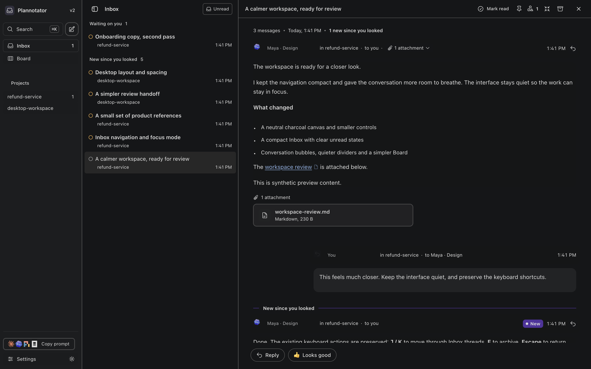
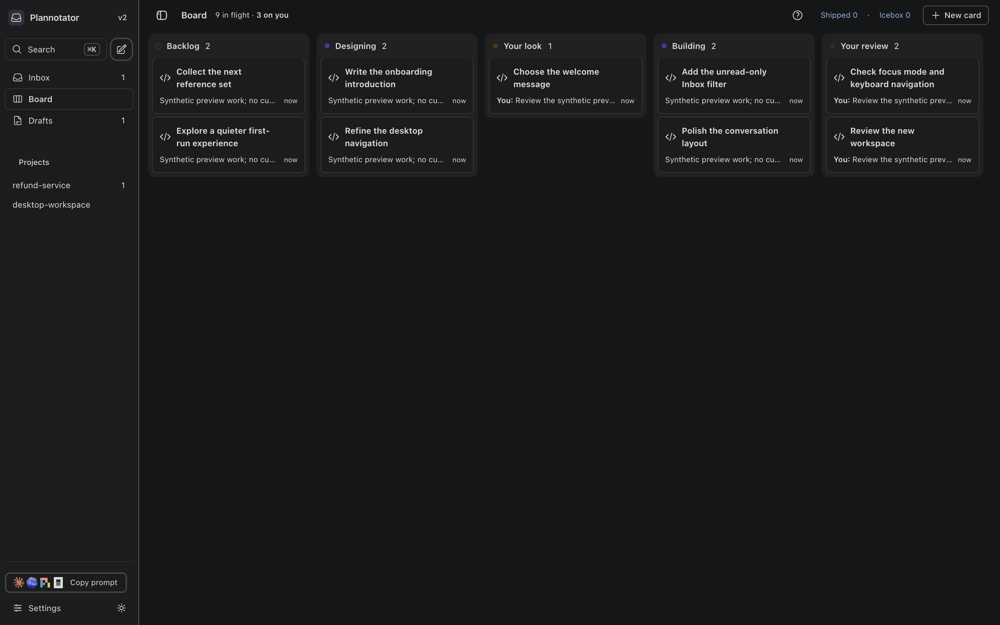

# plannotator-v2

This is a separate Plannotator fork with a Craft-reference visual system. It retains Plannotator's real Inbox, Board, question cards, attachments, plan review, code review and annotations; it is not a static mockup.

The desktop shell uses a 200 px navigation rail, a stable resizable message column, a quiet empty reading pane, compact system typography and a flat charcoal palette. The transcript has plain assistant copy and right-aligned replies; Board columns and cards use the same restrained surfaces. Small original provider marks give way to quiet row markers; agent attribution remains in the thread. Explicit decisions and review controls retain Plannotator's working contract.

The default palette has light and dark halves. Its public token reference is [Craft Agents](https://github.com/craft-ai-agents/craft-agents-oss), with attribution in `THIRD_PARTY_NOTICES.md`. No Craft identity or private walkthrough content is distributed. The primary visual target is the user's supplied walkthrough; public source tokens only supplement that evidence.

## Included behavior

- Mark read remains available after opening an update still displayed in New.
- E archives; Z undoes while its toast is present.
- Escape returns to Inbox, preserving inner editor and attachment comment guards.
- J opens the next visible Inbox thread; K opens the previous; no wrapping or typing interception.
- Command-period toggles focus mode without losing the thread or reply draft.
- Unread means unseen agent messages, independent of outstanding questions or actions. Opening a thread clears its unread emphasis without answering or dismissing those items. Unread filters the currently selected project's visible Inbox rows without closing the open thread or changing source order. Turn it off to show every row again. Tab to the filter and press Enter or Space; no extra letter shortcut was added.

## Coexistence

V2's browser cookies are namespaced, so changing its appearance or sidebar does not alter the original Inbox. Use `scripts/run-plannotator-v2.sh`; it sets `PLANNOTATOR_DATA_DIR` to `~/.plannotator-v2` unless you explicitly provide another path. It disables automatic agent reconnection by default and does not migrate or overwrite the original Inbox. Do not run the raw upstream CLI against your existing data directory merely to preview this fork.

The reviewed demonstration contains synthetic messages and cards. Connecting agents or bringing your real Inbox data across is a separate activation decision. The installed original remains available.

## Build and run

Use the repository's pinned Bun version (1.4.4) and frozen lockfile:

```sh
bun install --frozen-lockfile --ignore-scripts
bun run --cwd apps/review build
bun run build:hook
bun run build:opencode
mkdir -p .local/runtime
bun build apps/hook/server/index.ts --compile --no-compile-autoload-bunfig \
  --define '__CLI_VERSION__="0.28.33+plannotator-v2.craft.5"' \
  --outfile .local/runtime/plannotator
./scripts/run-plannotator-v2.sh
```

Pass normal CLI arguments to the launcher, e.g. `./scripts/run-plannotator-v2.sh inbox --background`.

## Browser compatibility

Aside's forced-dark layer can recolor an already-dark authored interface. V2 supplies component-scoped background roles to that layer for its dark palette; browser settings are not modified. The small compatibility block in `packages/inbox/craft.css` can be removed when the browser honors authored dark surfaces. It is inert in browsers that do not use those custom properties.

## Preview

These screenshots show only synthetic data on the compiled fork in Aside:





## Validation boundary

The candidate passed strict Inbox TypeScript checking, the review → hook → OpenCode build chain, the compiled Bun trust check, and 100 focused tests covering list/read behavior, project and unread filtering, archive, attachment guards, themes and cookie isolation. The focused list suite passed when run serially; one earlier run under build contention timed out and is retained with the private QA receipts.

The exact compiled `craft.5` candidate was exercised in Aside with synthetic data: Unread via keyboard preserves the open thread and row order; E/Z archive and undo; Command-period retains reply text and typing focus; Escape returns from both a thread and an attached Markdown file; J/K move to the next/previous visible thread; a seen waiting question leaves Unread without being dismissed; Board and Settings render; original Inbox appearance/layout cookie values remain unchanged.

Desktop dark mode is the qualified visual target. Native phone layout, physical keyboard input, printing, full repository tests, real agent delivery and migration of existing Inbox data have not been qualified. The shared original Inbox has not been replaced or restarted.
